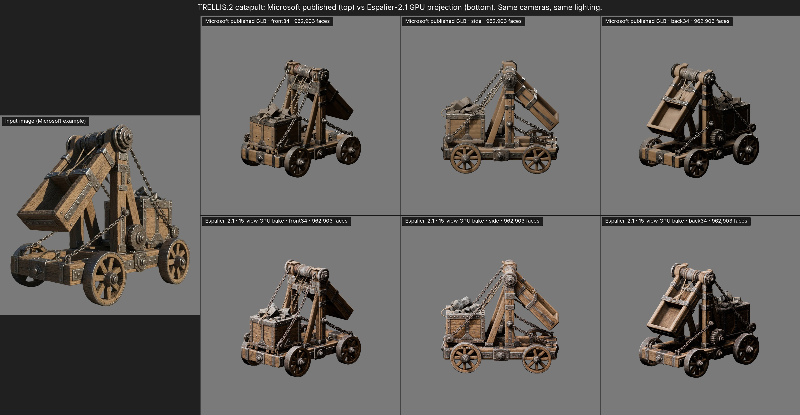
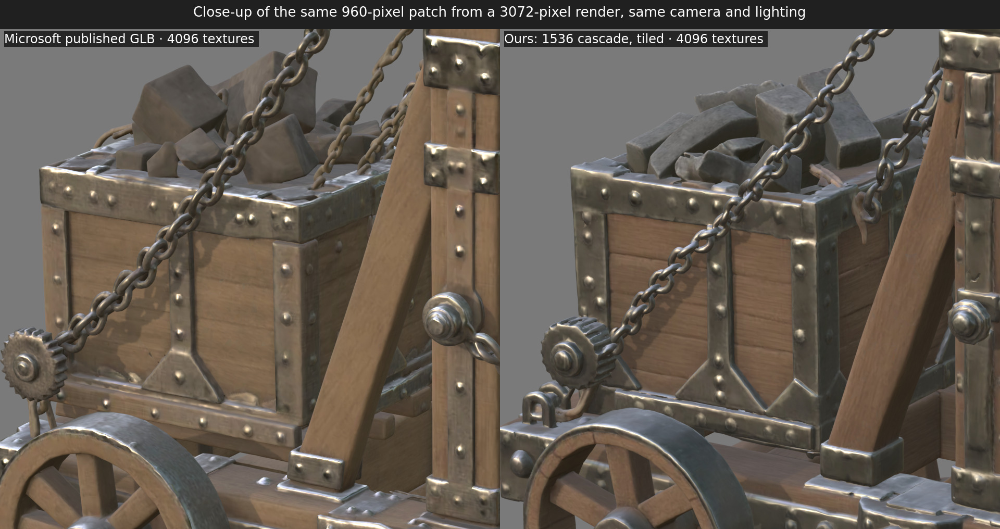

# over|yonder Espalier-2

over|yonder Espalier-2 runs Microsoft's [TRELLIS.2](https://github.com/microsoft/TRELLIS.2) image-to-3D model at its highest
resolution, the 1536 cascade, on a 16 GB consumer GPU. Microsoft lists a 24 GB GPU as the minimum, and on a 16 GB card
its 1536 pipeline runs out of memory. With Espalier-2's patches the same pipeline, with the same weights and settings,
generates and exports a textured GLB on an RTX 5070 Ti, including dense objects that Microsoft's code would generate at
a lower resolution. It runs Tencent's [Pixal3D](https://github.com/TencentARC/Pixal3D), which is built on TRELLIS.2, the
same way. The weights are read from their files as each stage needs them, so the process holds about 6 GiB
of system memory instead of 20 GiB.

An espalier is a fruit tree trained flat against a trellis, so a full-size tree grows in a narrow space.



The top row is Microsoft's published GLB for this input, from the TRELLIS.2 project page. The bottom row is
Espalier-2's output from the same input image at 1536, with seed 18. Microsoft doesn't publish the seed or resolution of its
gallery items, so the two are different samples of the same model. Up close, the 4096-pixel textures carry the same
level of detail:



The article [over|yonder Espalier-2: TRELLIS.2 at 1536 on a 16 GB GPU](https://over-yonder.tech/games/espalier/) explains how it
works, step by step, with every measurement.

## Memory

Measured on an RTX 5070 Ti (16 GB) with the desktop using another 2.3 GiB of the card. The catapult above is seed 18 of
its input image, and seed 8 is the largest surface among seeds 1 to 21 (20.8 million vertices). The water pot is a dense
object of 80,816 tokens, run with `--max-tokens 100000` (see below). The GPU peaks come from the NVIDIA driver, sampled
twenty times a second, and include CUDA's own allocations. The system memory is the generation process's peak resident
set.

| | Microsoft's code | Catapult, seed 18 | Catapult, seed 8 | Water pot |
| --- | --- | --- | --- | --- |
| Generation (flow models and decoders) | out of memory in the shape decoder | 11.9 GiB | 12.0 GiB | 13.0 GiB |
| GLB export (remesh, simplify, bake) | out of memory in the remesh | 8.3 GiB | 9.1 GiB | 11.5 GiB |
| System memory during generation | 20.1 GiB | 6.4 GiB | 5.6 GiB | 6.2 GiB |

Generating the catapult takes about 4.5 minutes and exporting it about 1 minute, while the pot takes about 10.5 minutes
to generate and 1.3 to export. Microsoft gives about 60 seconds on an H100. The system memory in Microsoft's column is
Espalier-2's catapult run with `TRELLIS_STREAM_WEIGHTS=0`, which loads the weights Microsoft's way and changes nothing
else.

## Dense objects

TRELLIS.2's 1536 cascade limits its high-resolution stage to 49,152 tokens. When an object has more, it lowers the
resolution by 128 at a time until it fits, as far as 1024, and prints "Due to the limited number of tokens, the
resolution is reduced to …". Of seeds 1 to 21 of the catapult, 15 ran at about 1408 for this reason.

`--max-tokens` raises the limit, so dense objects stay at 1536. Sampling them takes longer: the water pot's generation
took 10.5 minutes against the catapult's 4.5. Running their decoders' 384 stage whole also leaves almost no room on the
card, so above 49,152 Espalier-2 starts the decoder tiles at that stage, with 96-voxel tiles and a 16-voxel margin.

## Pixal3D

Pixal3D conditions TRELLIS.2's flow models on image features projected into the voxel grid, from one image or from
several posed views. `./install.sh --pixal3d` adds it to the same environment, and `--model pixal3d` runs it:

```sh
./espalier input.png out/ --model pixal3d
./espalier views/ out/ --model pixal3d
```

From one image, the camera's field of view is estimated with MoGe-2, as Pixal3D's `inference.py` does, or given with
`--fov`. Pixal3D builds the object in that camera's frame, so its orientation follows the camera's. A
directory of views needs a `transforms.json` with each view's pose and field of view, as Pixal3D's `inference_mv.py`
takes, and those cameras need to match the images. Its weights, both the single-view and multi-view sets, take 43 GB.

Measured as above, with Pixal3D's default settings at 1536:

| | Catapult image, seed 18 | Pixal3D's four-view example |
| --- | --- | --- |
| Generation | 10.3 GiB | 10.6 GiB |
| GLB export | 8.2 GiB | 6.3 GiB |
| Generation time | 6.3 minutes | 4.2 minutes |

## Untextured geometry

`--no-texture` skips the texture flow, the texture decoder and the bake, and exports the remeshed and simplified
geometry. The texture is sampled after the shape, so the geometry is identical to a textured run's, and the catapult's
generation takes about 3 minutes instead of 4.5.

## Changes

Espalier-2 changes seven places in Microsoft's code and CuMesh, and the same places in Pixal3D's copy of that code, and runs generation and export as separate processes.
The weights, samplers, seeds and export settings are Microsoft's.

| Where | Change | Effect on the output |
| --- | --- | --- |
| Weights (`trellis2.models.from_pretrained`) | Each network's weights are read from its safetensors file straight to the GPU when its stage runs, and freed when the stage ends, instead of being kept in system memory. `TRELLIS_STREAM_WEIGHTS=0` restores Microsoft's loading. | None. The output is bit-identical. |
| Shape and texture decoders (`SparseUnetVaeDecoder`) | The two highest-resolution stages run in overlapping spatial tiles, or the three highest with `--max-tokens` above 49,152. `TRELLIS_DECODE_MLP_CHUNK` can also run the per-voxel MLPs in chunks, which changes rounding, so Espalier-2 leaves it off. | Floating-point differences: at 1024 the largest feature difference is 0.016 on a 0 to 1 scale, and 0.002% of voxels differ. A single tile reproduces the untiled output exactly. |
| Shape decoder's mesh extraction (`o_voxel.convert.flexible_dual_grid_to_mesh`, `FlexiDualGridVaeDecoder`) | Its connectivity and triangle steps run over chunks of voxels and quads, and the decoded features are released before it runs. | None. The output is bit-identical. |
| Subdivisions (`Trellis2ImageTo3DPipeline.decode_latent`) | The texture decoder reuses the shape decoder's subdivisions, whose cached neighbour maps are cleared before it runs, and the subdivisions and PyTorch's cached memory are released before CuMesh fills holes. | None. The output is bit-identical. |
| Narrow-band remesh (`cumesh.remeshing.remesh_narrow_band_dc`) | Its connectivity and triangle steps run over chunks of voxels and quads, its intermediate points and distances are freed once used, and the vertices its quads use are found with a mask instead of a sort and remapped in place. | None. The output is bit-identical. |
| Simplifier (CuMesh `simplify_step`) | Each step frees the edge pass's scratch and edge-face counts before the collapse, and builds the vertex-face adjacency after the edge sort. | None to the computation. CuMesh's simplifier isn't deterministic, so its meshes differ slightly from run to run, as they do with Microsoft's build. |
| GLB export (`o_voxel.postprocess.to_glb`) | The texture volume stays in system memory until the bake. The previous mesh is released before the remesh, and PyTorch's cached memory before CuMesh builds the remeshed mesh. | None. |
| Pixal3D (`patches/pixal3d.patch`) | The decoder, weight and subdivision changes above, ported to its copy of TRELLIS.2's code. Its projection conditioner projects only the occupied cells instead of the whole grid, and its NAF upsampler's cross-attention runs in tiles that carry their full attention neighbourhood. | The tiles' floating-point differences, as for the decoders. The projection is bit-identical. |
| Untextured export (`run(texture=False)`, `to_glb(bake=False)`) | The texture can be skipped, and the export then stops after simplifying. | None to the geometry. |
| Running the pipeline (`espalier.py`) | Generation and export run in separate processes, `--max-tokens` sets the token limit, and `--model` chooses TRELLIS.2 or Pixal3D. | None. |

The patches are in [patches/](patches), against TRELLIS.2 `75fbf01`, CuMesh `12289e1` and Pixal3D `f7cf384`.

## Installing

Espalier-2 needs Linux, an NVIDIA GPU with 16 GB, the CUDA toolkit 12.8 or later with a GCC it supports, `git` and
[`uv`](https://docs.astral.sh/uv/), plus `cmake` and `make` for Pixal3D. It has been run on an RTX 5070 Ti (Blackwell,
compute capability 12.0).

```sh
git clone https://github.com/overyonder/espalier
cd espalier
./install.sh
```

`install.sh` clones TRELLIS.2, CuMesh, FlexGEMM, nvdiffrast and nvdiffrec at fixed commits, applies the patches, and
builds the CUDA extensions into `.venv` for your GPU's compute capability. It installs PyTorch 2.8 with CUDA 12.8 and
flash-attn 2.8.3, the first releases with kernels for Blackwell GPUs. `./install.sh --pixal3d` also clones Pixal3D,
applies its patch and installs its requirements, with MoGe pinned to the commit current when they were written, NATTEN 0.21.0
built for your GPU, and Pixal3D's build of utils3d.

Two of the models TRELLIS.2 loads are gated on Hugging Face. Request access to
[DINOv3 ViT-L/16](https://huggingface.co/facebook/dinov3-vitl16-pretrain-lvd1689m) and
[RMBG-2.0](https://huggingface.co/briaai/RMBG-2.0), then log in with `hf auth login`. RMBG-2.0 only removes the
background of images without an alpha channel, and its licence is non-commercial. For images that already have
transparency, `--no-rembg` skips it.

## Running

```sh
./espalier input.png out/
```

This writes `out/model.glb`, plus `out/raw.pt` with the full-resolution mesh and voxel attributes. The options:

| Option | Default | Meaning |
| --- | --- | --- |
| `--model` | `trellis2` | `trellis2` or `pixal3d` |
| `--pipeline` | `1536_cascade` | Any of Microsoft's pipelines: `512`, `1024`, `1024_cascade`, `1536_cascade`; Pixal3D has the two cascades |
| `--seed` | 42 | Sampling seed |
| `--tile` | 256 at 1536, 96 above the token limit, off otherwise | Decoder tile edge in voxels; 0 turns tiling off |
| `--max-tokens` | 49152 | Token limit of the 1536 stage. Above it the resolution steps down, so raising it keeps dense objects at 1536 |
| `--texture` | 4096 | Texture size in the GLB |
| `--faces` | 1000000 | Face target of the GLB |
| `--no-texture` | off | Skip the texture and export the untextured geometry |
| `--fov` | estimated | Pixal3D from one image: the camera's horizontal field of view in degrees |
| `--no-rembg` | off | Don't load RMBG-2.0; the input needs an alpha channel |
| `--dinov3` | Meta's repository | TRELLIS.2: another Hugging Face repository holding DINOv3 ViT-L/16 |

## Licence

Espalier-2 is licensed under MIT-SLOP, MIT with an automated-use condition; see [LICENSE](LICENSE). TRELLIS.2, its weights, CuMesh, FlexGEMM, Pixal3D and its weights, MoGe and NATTEN are MIT licensed.
DINOv3 and RMBG-2.0 have their own licences.
