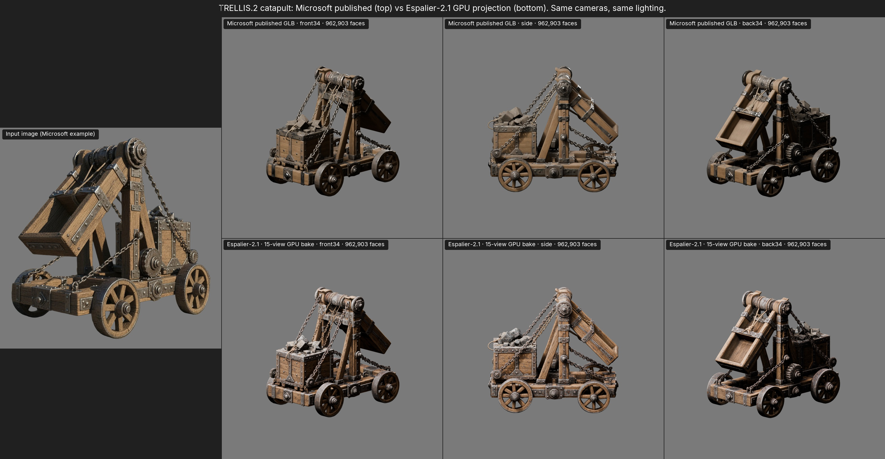
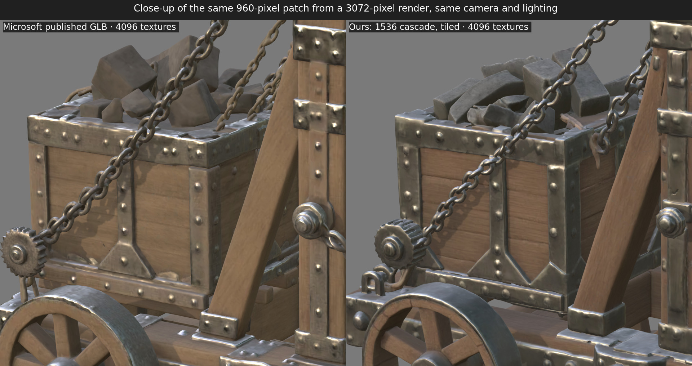

# over|yonder Espalier-2.1

over|yonder Espalier-2.1 generates game-ready, high-fidelity 3D assets from a single reference image on a 16 GB consumer
GPU (RTX 5070 Ti).

Earlier image-to-3D models attempted to generate geometry and surface textures in a single latent pass, resulting in
soft, blurry voxel textures and noisy geometry. Espalier-2.1 completely decouples geometry reconstruction from
surface appearance and multi-view projection painting:

1. **Precision Neural Shape**: Tencent's [Hunyuan3D-2.1](https://github.com/Tencent-Hunyuan/Hunyuan3D-2.1) generates a watertight 3D occupancy field at 100 flow matching steps and octree resolution 512.
2. **Dense Surface Extraction**: GPU Dual Marching Cubes (DMC via `diso`) extracts the manifold triangular surface.
3. **Decimation & Repair**: CuMesh cleans duplicate geometry, fills holes, and decimates the dense mesh to a production-ready 56,000 face budget.
4. **UV Unwrapping**: CuMesh and xatlas parameterize and pack clean UV charts into a standard 0–1 texture atlas.
5. **Base PBR Albedo**: Microsoft's [TRELLIS.2](https://github.com/microsoft/TRELLIS.2) is repurposed as a shape-conditioned voxel texturing engine, baking base color, roughness, and metallic into a 4096×4096 atlas without seams.
6. **15-Camera Resident GPU Projection Painting**: Eight orbit views at 15°, four elevated views at 50°, and three underside views at -50° cover the model. GPU rendering and projection share the exact saved cameras. Each view is repainted against the reference, then all views are projected onto the 4096 atlas by the resident Vulkan baker with cosine-to-the-tenth weighting and BC7 encoding. The mesh, UVs and base PBR material are preserved.

Every stage runs in an isolated child process, ensuring that CUDA contexts, model weights, and allocations are completely reclaimed by the operating system before the next stage begins.



The top row is the GLB published on the Microsoft TRELLIS.2 project page. The bottom row uses GPT-image painting and a 2× upscaled 8192-pixel albedo from the same input image, showing wood grain, iron hardware, rivets, and torsion rope:



## Detail Painting

The detail pass runs multi-view projection painting over the 4096 texture atlas:

- **Offline Local Default (`--paint flux`)**: Uses [FLUX.3 [klein]](https://github.com/black-forest-labs/flux-3-image-klein) with sequential model offloading to run locally on a 16 GB GPU.
- **Codex GPT-Image (`--paint gpt` or `--gpt-image`)**: Uses the ChatGPT plan's Codex endpoint (authenticating through local `~/.codex/auth.json`).
- **Base PBR Only (`--paint none`)**: Skips the detail painting pass and exports the base TRELLIS.2 PBR texture.

In our comparison tests, local FLUX and Qwen inpainting did not preserve reference colours adequately. Our tested workflow requires API inpainting for good reference-colour fidelity. FLUX remains the default local option.

New cameras fit the lens and shift so the object's outline fills 92% of the canvas from the same viewpoint. Each GPT painting is compared with its input render for size, placement and silhouette shape. A view that is missing or fails has its saved camera fitted the same way, is rendered again and painted again, up to three attempts, keeping the best. Rejected paintings stay in the work directory's `attempts/`, `paint-check.json` beside the paintings records each result so a resume doesn't repeat them, and a reused `--cameras` file is rewritten to stay paired with the paintings. `--paintings` is used as given, without checks.

GPT painting sends one request at a time, with at least ten seconds between request starts. Transient HTTP errors (400, 408, 409, 429 and 5xx) and connection failures receive up to five retries with exponential backoff and jitter. Server `Retry-After` delays are honoured; authentication and exhausted-quota errors stop the run. Completed paintings are reused when resuming. FLUX expands pending captions in one prompt-model process, then paints pending views in one separate image-model process, loading each model once per batch.

The detail pass uses the Real-ESRGAN SDK with x4plus weights, 512-pixel tiles, 16-pixel tile padding and fp16 inference. Native 4× output is reduced with Lanczos for 2× paintings. It applies 2× upscaling to the camera paintings before projection by default. The baked atlas remains 4096×4096. Use `--upscale 4` for native 4× paintings or `--upscale 0` to bake the original paintings.

Add `--texel-density-map` to write `<model>-texel-density.png` and a TOML summary beside the finished GLB. The map compares final atlas texels with pixels in the sharpest visible source painting, accounting for occlusion and the baker's grazing cutoff. Blue is 0.5 texels per source pixel, cyan 1, green 2, yellow 4, orange 8 and red 16 or more. Grey marks the baker's four-texel gutter, black is outside the padded charts, and magenta has no eligible camera view. The summary separates UV occupancy, gutter and unassigned space and reports density percentiles. This measures the projection sources, independently of gameplay camera distance.

By default, the fallback atlas is matched to the brightness, contrast and RGB grade of the painted views before baking. Calibration uses corresponding foreground regions with equal weight per camera; the source paintings and approved mesh remain unchanged. `--no-base-colour-match` disables this step. Original and matched base atlases plus the fitted channel gains and offsets are retained in the bake directory.

The baker retains the base colour atlas wherever no eligible painted foreground reaches the mesh. Transparent pixels and the empty black painting canvas do not overwrite that base. Hidden RGB under transparency is removed before upscaling and input compression. An existing `--base-model` keeps its geometry, UV layout and stored or implicit normals. Use `--base-material TRELLIS.glb` when a separately textured export has the same positions, indices and UVs but omitted those normals; this is validated before painting. The output retains the approved base model’s material settings and maps. The base texture stage also retains the input mesh rather than reconstructing it when attaching its material.

The final asset is always exported cleanly to `<output>/model.glb` (or the specified `.glb` path).

### Painting base

The painting base guides the placement of surface features; the reference image supplies their appearance.

- **TRELLIS textured render (default):** Use this for objects with rotational or mirror symmetry that can make different sides ambiguous. The existing texture provides appearance cues that help keep features in place and reduce duplication, such as eyes painted onto the back of a head.
- **Normals render:** Use this for objects without that symmetry ambiguity when the painting would benefit from closer conformance to fine surface details already present in the mesh. Normals describe the surface orientation and relief without carrying over the base texture's colours or painted features.

Select the painting base with `--paint-base trellis` or `--paint-base normals`. TRELLIS is the default.

## Memory

Measured on an NVIDIA GeForce RTX 5070 Ti (16 GB VRAM) generating the benchmark catapult:

| Stage | Technology | Peak VRAM | Time |
| --- | --- | --- | --- |
| 1. Cutout | RMBG-2.0 | 2.4 GiB | 3s |
| 2. Shape Generation | Hunyuan3D-2.1 (100 steps, octree 512) | 12.8 GiB | 140s |
| 3. Surface Extraction | GPU Dual Marching Cubes (`diso`) | 4.2 GiB | 4s |
| 4. Mesh Reduction | CuMesh cleaning & decimation (56k faces) | 3.8 GiB | 6s |
| 5. UV Unwrapping | CuMesh xatlas UV packing | 2.1 GiB | 5s |
| 6. Base PBR Texture | TRELLIS.2 shape-conditioned voxels (4096²) | 11.9 GiB | 45s |
| 7. Detail Painting | 15-view resident Vulkan baker | | |

Because each stage runs in an independent child process, peak VRAM never accumulates across models.

## Installing

Espalier-2.1 requires Linux, an NVIDIA GPU with at least 16 GB VRAM, the CUDA toolkit 12.8 or later with a supported GCC, `git`, [`uv`](https://docs.astral.sh/uv/), Rust/Cargo, `pkg-config`, and development packages for Vulkan, libpng and nlohmann-json. Painting inputs are rendered with nvdiffrast; Blender is used only by the separate documentation-rendering tools.

```sh
git clone https://github.com/overyonder/espalier
cd espalier
./install.sh
```

`install.sh` clones TRELLIS.2, CuMesh, FlexGEMM, nvdiffrast, nvdiffrec, and Hunyuan3D-2.1 at pinned commits, applies memory-optimization patches, and builds the CUDA extensions into `.venv`.

To install the optional local FLUX.3 [klein] weights and pipeline:
```sh
./install.sh --flux
```

FLUX uses a separate Python environment because its dependencies differ from the geometry and texturing models. Download its NVFP4 weights and prompt-upsampler weights using the pinned FLUX checkout's README. Place `RealESRGAN_x4plus.pth` in `src/Hunyuan3D-2.1/hy3dpaint/ckpt/`, or set `REALESRGAN_WEIGHTS` to its location.

### Hugging Face Access

Two models loaded by the pipeline require accepted terms on Hugging Face:
- [DINOv3 ViT-L/16](https://huggingface.co/facebook/dinov3-vitl16-pretrain-lvd1689m) (or specify `--dinov3 devvcamp07/dinov3-mirror`)
- [RMBG-2.0](https://huggingface.co/briaai/RMBG-2.0)

Log in once with `hf auth login` before running. If your input image already has an alpha channel, `--no-rembg` skips RMBG-2.0.

## Running

```sh
# Default hybrid pipeline with local FLUX.3 detail painting
./espalier input.png out/

# With Codex GPT-image detail painting
./espalier input.png out/ --paint gpt

# Paint camera-space normals instead of the TRELLIS texture
./espalier input.png out/ --paint gpt --paint-base normals

# Resume completed stages and paintings
./espalier input.png out/ --paint gpt --resume

# Repaint an existing model while preserving its geometry and UVs
./espalier reference.png out/ --base-model base.glb --paint gpt

# Output directly to a specific GLB file
./espalier input.png path/to/model.glb

# Base geometry and PBR texture only (skip detail painting)
./espalier input.png out/ --paint none
```

### Options

| Option | Default | Meaning |
| --- | --- | --- |
| `--paint` | `flux` | Detail painter: `flux` (local FLUX.3 [klein]), `gpt` (Codex endpoint), or `none` |
| `--gpt-image` | off | Shortcut for `--paint gpt` |
| `--faces` | `56000` | Target triangle count for simplified geometry |
| `--texture` | `4096` | Texture atlas resolution (width and height) |
| `--seed` | `12345` | Random seed for shape generation |
| `--steps` | `100` | Hunyuan3D-2.1 flow matching diffusion steps |
| `--octree` | `512` | Hunyuan3D-2.1 occupancy field resolution |
| `--no-rembg` | off | Skip RMBG-2.0 (input image must already have an alpha channel) |
| `--dinov3` | Meta repo | Alternative Hugging Face repo for DINOv3 |
| `--upscale` | `2` | Real-ESRGAN camera-painting super-resolution before baking: `2` doubles each dimension, `4` quadruples it, `0` disables it; the atlas stays 4096² |
| `--texel-density-map` | off | Write a density PNG and TOML occupancy summary after the painted model is complete |
| `--prompt-file` | prompts/progressive_paint.txt | Path to custom detail repainting prompt |
| `--paint-base` | `trellis` | Painting input: `trellis` textured render or `normals` render |
| `--base-material` | none | Painting/fallback material with matching positions, indices and UVs; output material stays with `--base-model` |
| `--base-model` | unset | Repaint an existing textured GLB, skipping shape and base-texture generation |
| `--cameras` | unset | Reuse exact saved camera transforms, lens and image resolution |
| `--paintings` | unset | Bake a saved directory of camera-named PNG paintings; requires `--cameras` |
| `--painting-output` | unset | Reuse and complete camera-named paintings in this directory; requires `--cameras`; use `--paintings` for a complete read-only set |
| `--work-dir` | automatic | Separate intermediate directory for this output |
| `--resume` | off | Reuse completed generation stages and paintings in the output work directory |
| `--model` | `hybrid` | Pipeline architecture: `hybrid` (Espalier-2.1), `trellis2`, or `pixal3d` |

Existing installations can be reused through `ESPALIER_SHAPE_ROOT`, `ESPALIER_TRELLIS_ROOT` and `ESPALIER_FLUX_ROOT`. Set `ESPALIER_SHAPE_PYTHON`, `ESPALIER_TEXTURE_PYTHON` and `ESPALIER_FLUX_PYTHON` to their environment interpreters. Upscaling uses `ESPALIER_UPSCALE_PYTHON`, falling back to the shape interpreter and then the texture interpreter. Its environment needs BasicSR 1.4.2 and Real-ESRGAN 0.3.0. The default roots are the corresponding checkouts under `src/`; shape and texture stages otherwise use Espalier's environment.

## Image generation

`python3 tools/chatgpt_image.py PROMPT_FILE OUT.png [IMAGE ...] [--size WxH]` generates or edits images through the same paced ChatGPT client used by GPT painting. Input images are supplied in attachment order. It uses the Codex login; image requests, TLS handling and retries have one implementation in `tools/chatgpt_image.py`.

On NixOS, source `tools/nixos-environment.sh` once before a CLI run or batch.

## Licence

Espalier-2.1 is licensed under MIT-SLOP, MIT with an automated-use condition; see [LICENSE](LICENSE).
TRELLIS.2, its weights, CuMesh, FlexGEMM, Hunyuan3D-2.1, Pixal3D, MoGe, and NATTEN are MIT licensed.
DINOv3 and RMBG-2.0 have their own respective upstream licences.
